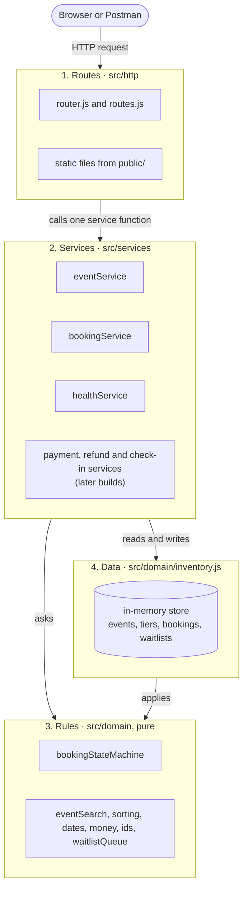
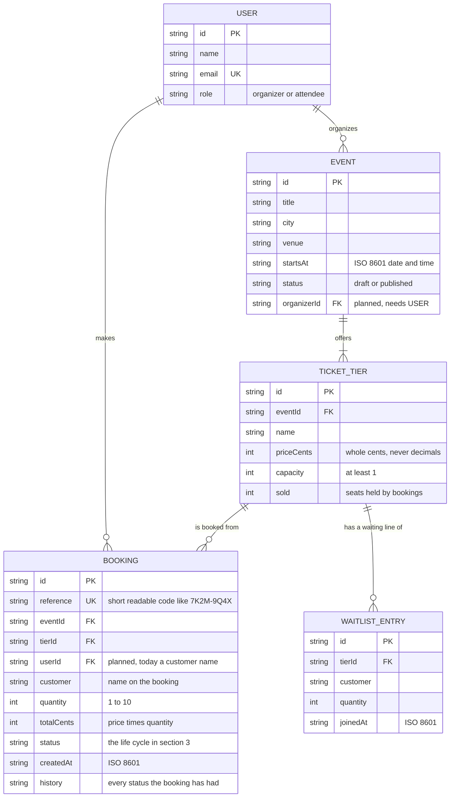
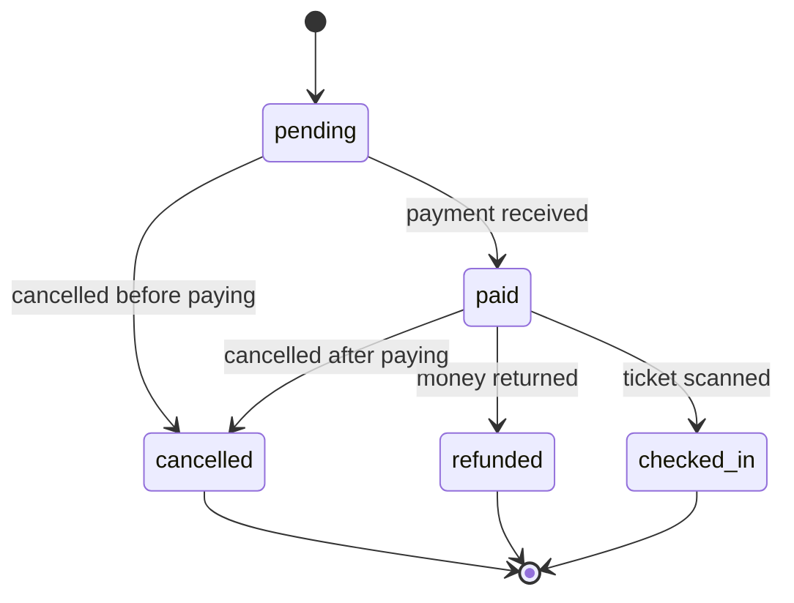

# Architecture

How the Event Ticketing system is organised, how a booking lives and dies, and what data it keeps.
Three diagrams, then the detail behind each. The diagrams are [Mermaid](https://mermaid.js.org/) text: GitHub and
VS Code (with a Mermaid extension) draw them for you.

1. [The layers](#1-the-layers): who may call whom
2. [The data model](#2-the-data-model): events, ticket tiers, bookings, users
3. [The booking life cycle](#3-the-booking-life-cycle): every state and every allowed move

---

## 1. The layers

The system is built in four layers. A request enters at the top and moves **down**. **Nothing calls upwards.**

**What each layer may and may not do** (one sentence each):

- **Routes** (`src/http`) may read the request (method, path, `:params`, JSON body), call one service function and turn its result or its error into a JSON response, but may not contain business rules, touch the data, or import the rules directly.
- **Services** (`src/services`) may combine rules and data into one use case ("pay a booking") and decide the order of the steps, but may not know about HTTP (no request, no response, no status codes) or call a route.
- **Rules** (`src/domain`, the pure files) may only decide things from the values they are given (is this move allowed? does this event match?) and throw a `DomainError`, but may not read or write data, touch the network, files or the clock, or call any other layer.
- **Data** (`src/domain/inventory.js`) may store and fetch records and keep them consistent (seats sold always match the bookings), but may not know about HTTP or services, and must ask the rules before it changes a booking's status.

**The dependency rule, in one table.** `test/architecture.test.js` reads every `import` in the project and fails if an arrow points the wrong way.

| A file in... | may import from |
|--------------|-----------------|
| `src/http` (routes) | `src/http`, `src/services`, and **only** `domain/errors.js` (to recognise errors) |
| `src/services` | `src/services`, `src/domain` |
| `src/domain` (rules) | other rule files, never `inventory.js`, never `services` or `http` |
| `src/domain/inventory.js` (data) | `src/domain` rule files |
| `src/ui` (React) | `src/domain` for now (see below) |

**Where things are today.** The pure rules are separate files: `bookingStateMachine.js`, `eventSearch.js`,
`sorting.js`, `dates.js`, `money.js`, `ids.js`, `waitlistQueue.js`. Rules that must happen *together with* a data change
(never sell more seats than exist, people waiting go first) live in `inventory.js`, next to the data they protect.
When a real database arrives, `inventory.js` splits into repositories (data) and services (the use cases around them).
The services folder holds three services today: `eventService` (create, tiers, publish, search), `bookingService` (book, find, cancel) and `healthService`.
The payment, refund and check-in services arrive with the stories that need them (S07, S09, S10...).

**The React screen** (`src/ui`) is a separate client. The API now has event and booking routes, but the screen still runs the domain in
the browser; switching it to call the HTTP API (and dropping the domain import) is a later step.

**The journey of `GET /health`:** the client sends the request, `app.js` finds the route in the router, the route handler calls
`services.health.check()`, the service returns `{ status: 'ok' }`, and `app.js` writes it as JSON. If anything throws,
`app.js` turns it into `{ "error": { "code", "message" } }`. The client never sees a stack trace.

---

## 2. The data model

Notes:

- **`USER` does not exist in the code yet.** It is in the picture because organizers and attendees arrive in a later build. Fields marked *planned* are the ones that will be added then. Today a booking carries only the customer's name.
- **Money is whole cents** (kobo): `500000` is ₦5,000.00. Never decimals.
- **`sold` follows the bookings:** it counts the seats of every booking in a state that holds seats (`pending`, `paid`, `checked_in`). `cancelled` and `refunded` give them back.
- **A tier belongs to exactly one event**, and a booking is for exactly one tier (1 to 10 tickets).
- **Drafts are private.** Only `published` events are public and bookable.
- **Dates are ISO 8601 strings.** A time with no zone means Lagos time (+01:00).

---

## 3. The booking life cycle

A booking is always in **exactly one** of five states, and can only move along the arrows. Anything else is refused
with `INVALID_TRANSITION` (for example paying a cancelled booking).

| State | Meaning | Holds seats? | May move to |
|-------|---------|:------------:|-------------|
| `pending` | Booked, seats held, waiting for payment | yes | `paid`, `cancelled` |
| `paid` | Payment received | yes | `checked_in`, `refunded`, `cancelled` |
| `cancelled` | Cancelled. **Final** | no | nothing |
| `refunded` | Paid, then the money was returned. **Final** | no | nothing |
| `checked_in` | The attendee arrived and the ticket was scanned. **Final** | yes | nothing |

**Rules of the life cycle**

- A new booking is always `pending`.
- Exactly five moves are allowed (the arrows above). Of the 25 possible (from, to) pairs, 20 are illegal, including moving to the state you are already in.
- `cancelled`, `refunded` and `checked_in` are **final**: nothing leaves them.
- A move that gives seats back (to `cancelled` or `refunded`) releases them in the same step; a refused move changes nothing.
- Every status change goes through **one function**, `transitionBooking`, which asks the state machine first. Nothing else sets `status`.
- Every change is recorded in the booking's `history`.
- The moves are **data** (`MOVES` in `src/domain/bookingStateMachine.js`). The diagram above is generated from that data, and `test/booking-state-machine.test.js` fails if this picture and the code ever disagree. To refresh it, run:
  `node -e "import('./src/domain/bookingStateMachine.js').then(m => console.log(m.bookingStatesToMermaid()))"`

**Where later stories plug in:** S07, S09 and S10 will be built on these moves, for example *payment* is the move `pending → paid`,
*refund* is `paid → refunded`, and *check-in* is `paid → checked_in`. They will call `transitionBooking`; none of them may set a status itself.
Rules about *when* a move is allowed (for example, no check-in before the event starts) belong to those stories, on top of the table.

---

## 4. The web server (skeleton)

Built on `node:http` only, with no outside packages.

| Request | Response |
|---------|----------|
| `GET /health` | `200 {"status":"ok"}` |
| `POST /api/events`, `GET /api/events`, `GET /api/events/:id`, `POST /api/events/:id/tiers\|publish\|unpublish` | the event routes (see [api.md](api.md)) |
| `POST /api/bookings`, `GET /api/bookings/:reference`, `POST /api/bookings/:reference/cancel` | the booking routes |
| `POST /api/dev/bookings/:reference/transition` | **demo mode only** (`npm run start:demo`): a practice route for the state machine |
| any unknown `/api/...` path | `404 {"error":{"code":"NOT_FOUND","message":"..."}}` |
| a known path with the wrong method | `405` + an `Allow` header |
| a body that is not valid JSON | `400 {"error":{"code":"BAD_JSON","message":"..."}}` |
| a body that is not sent as JSON | `415` |
| a body that is too big | `413` |
| any other path | a file from `public/` (`/` serves `public/index.html`), or `404` |
| any bug on the server | `500 {"error":{"code":"INTERNAL","message":"Something went wrong"}}`, with the stack trace in the **server log only** |

How a `POST /api/bookings` travels: `app.js` reads the JSON body, the router finds the route, the route calls `services.bookings.book(body)`,
the service calls `bookTickets` (the data layer), which asks the rules (is the event published? are there enough seats? is anyone waiting?).
A `SOLD_OUT` error travels back up, and `app.js` turns it into `409 {"error":{"code":"SOLD_OUT",...}}`.

**One error shape, everywhere:** `{ "error": { "code": "...", "message": "..." } }`, nothing more, nothing less.
A domain error maps to an HTTP status through one table (`src/http/errors.js`), for example `VALIDATION` is `400`,
`NOT_FOUND` is `404`, and every conflict (`SOLD_OUT`, `INVALID_TRANSITION`...) is `409`. A test fails if a new domain error code has no status.

**Static files can never escape `public/`:** the path is decoded, checked, resolved against `public/`, and the real path (after symlinks) must still be inside it.
Encoded `..`, backslashes, null bytes and dotfiles are all refused (tested one by one).

**Configuration** (`src/config.js`): `PORT` (default `3000`; `0` means "any free port"), `HOST` (default `127.0.0.1`), and demo mode (`--demo` or `DEMO=true`).
A bad `PORT` stops the server at start-up with a clear message.
